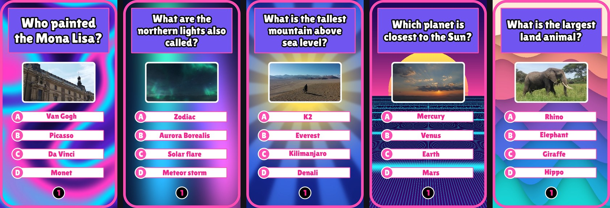

# Quizclips

**Turn a topic into a finished vertical quiz video.** Pick a video type, type a topic (or leave it blank for a surprise) and click **Generate**. Quizclips writes the script, finds matching stock footage, records the narration, mixes the sound and renders a 1080x1920 MP4 ready for TikTok, Reels and Shorts.


**Live site:** _coming soon_
**Demo video:** _coming soon_ (an `.mp4` dragged into this file on GitHub plays right here)



## What it does

- **Nine video types:** trivia, personality quiz, would you rather, quest, rankings, fun facts, odd one out, guess the clip and what's missing ([details](docs/VIDEO_TYPES.md)).
- **Footage that fits each question.** Clips are scored against their own tags, optionally checked by a vision model, and swapped out when nothing fits.
- **Narration** from Microsoft's free neural voices, cleaned and levelled.
- **A sound mix desk** with separate levels for the voice, choice sounds, correct-answer ding, whoosh and timer, presets and a live preview.
- **24 looks** with a phone preview that redraws as you change colours.
- **Your own content:** every type has an editor for typing the questions yourself.
- **Built for a public site:** content rules, AI review of typed text and per-visitor and per-site limits ([details](docs/SAFETY.md)).

## How it works

1. **Script.** `content.py` asks a language model for the questions and the footage searches (plain trivia comes from Open Trivia DB).
2. **Footage.** `videos.py` searches Pixabay, scores each clip's tags against the search, and downloads the best match. Rounds without good footage are replaced by ones that have it.
3. **Voice.** `tts.py` synthesizes every line and `audio.py` filters and levels it.
4. **Scenes.** `render.py` draws each overlay with Pillow and composites it over the footage with ffmpeg.
5. **Mix.** Every sound goes on its own track, the Mix levels are applied, and a limiter protects the result.
6. **Finish.** The scenes are joined, the audio is added and the video is saved.

The full picture, with a diagram, is in [docs/ARCHITECTURE.md](docs/ARCHITECTURE.md).

## Engineering highlights

- **Matching footage is the hard part.** Stock-video search is loose, so results are scored on whole-word tag matches, rejected when only a generic word matches, and checked by a vision model when one is configured. If an exact subject has no footage the round is dropped or falls back to the closest plain match, never a random clip.
- **Frame-exact timing.** Every scene is a whole number of frames, so narration and sound effects stay in step with the picture across a two-minute video.
- **A real sound mix.** Sounds are tagged by lever and mixed as true dB changes after one loudness fit, with a clean limiter.
- **One pacing setting for every format.** The pause after an answer and the transition length are shared, so every video type feels the same.
- **Safety by design.** Layered rules, review of typed text, a check of everything the AI writes, rate limits and a moderation log that never stores accepted text.
- **Deployed, not just local.** It runs on an AWS server behind Caddy with HTTPS ([docs/DEPLOYMENT.md](docs/DEPLOYMENT.md)).

## Tech

| Area | Used |
| --- | --- |
| Backend | Python, FastAPI, Uvicorn |
| Video and graphics | ffmpeg (via `imageio-ffmpeg`), Pillow, NumPy |
| Audio | Edge TTS voices, custom mixer and limiter in NumPy |
| AI | Gemini or Claude for scripts and footage searches, optional vision check |
| Footage | Pixabay (Pexels optional) |
| Frontend | Plain HTML, CSS and JavaScript, no build step |
| Hosting | AWS Lightsail (Ubuntu), systemd, Caddy |
| Tests | `unittest`, run by GitHub Actions |

About 7,500 lines of Python.

## Run it locally

1. Install Python 3.10 or newer.
2. Get a free Pixabay key at [pixabay.com/api/docs](https://pixabay.com/api/docs/).
3. Start the app:
   - **Mac:** double-click `run_mac.command` (or run `./run_mac.command`).
   - **Windows:** double-click `run_windows.bat`.
   - **Terminal:** `pip install -r requirements.txt`, then `python tools/set_key.py`, then `python app.py`.
4. The first run asks for your key and saves it to `.env`. Your browser opens http://localhost:8000.

Videos are saved in `output/`. Optional keys (Gemini for the non-trivia types, Anthropic for better questions) and all other settings are in [docs/CONFIGURATION.md](docs/CONFIGURATION.md).

## Tests

```bash
python3 -m unittest discover tests
```

The tests need no network or keys. They cover the safety rules and limits.

## Documentation

- [Architecture](docs/ARCHITECTURE.md)
- [Video types](docs/VIDEO_TYPES.md)
- [Configuration](docs/CONFIGURATION.md)
- [Safety and limits](docs/SAFETY.md)
- [Deployment](docs/DEPLOYMENT.md)

## What I'd improve next

- Move video generation to a proper job queue and store finished videos in object storage, instead of in-process threads and local files.
- Package the app with Docker and deploy automatically from GitHub.
- Add tests for the footage matching, audio mixing and timing, not only the safety rules.
- Add user accounts and quotas.
- Upload finished videos to TikTok as drafts through its API.

## Credits and licenses

- Stock footage from [Pixabay](https://pixabay.com) (credited on the site).
- Emoji graphics are [Twemoji](https://github.com/jdecked/twemoji), CC-BY 4.0 (`assets/emoji/LICENSE.txt`).
- Fonts Bangers and Lilita One are under the SIL Open Font License (`assets/fonts/OFL.txt`).
- Voices from Microsoft Edge's text-to-speech service through the `edge-tts` package.

The code is not open source: all rights reserved unless a license file says otherwise.
