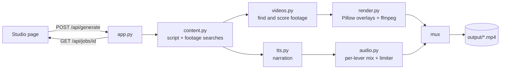

# Architecture

Quizclips is a single FastAPI process. A request to `/api/generate` starts a background job; the browser polls `/api/jobs/<id>` for progress and then plays the finished MP4 from `/output`.

## Design notes

- **Footage must fit the question.** A clip is accepted only if enough of the search words appear in its own tags; an optional vision model can then reject near misses, and a plain-word search is the last resort before an abstract background.
- **Frame-exact timing.** Every scene is a whole number of video frames, so audio placed by adding scene lengths stays in step with the picture.
- **One pacing setting for every video type.** The pause after the narrator finishes an answer (`PAUSE_AFTER_SECONDS`) and the transition between scenes (`TRANSITION_SECONDS`) are shared.
- **Sound mix.** Each sound belongs to a lever (voice, choice, ding, whoosh, timer). Levels are applied as real dB changes after one loudness fit, and a clean limiter protects the end result.
- **Safety in layers.** Rules, an optional AI review of typed text, a check of what the AI writes, and per-visitor and per-site limits (see [SAFETY.md](SAFETY.md)).

| File | What it does |
| --- | --- |
| `run_mac.command`, `run_windows.bat` | One-click launchers (install, set key on first run, start) |
| `tools/set_key.py` | Asks for your key and saves the `.env` file |
| `app.py` | Web server and the Generate button |
| `pipeline.py` | Builds one video start to finish and sets the timing |
| `questions.py` | Gets questions, shuffles answer letters, builds video search words |
| `videos.py` | Searches and downloads background videos (Pixabay and Pexels) |
| `tts.py` | AI narration |
| `audio.py` | Mixing and the bing / tick / pop sounds |
| `render.py` | Draws the quiz graphics and renders each scene with ffmpeg |
| `safety.py` | Content rules, AI review, visitor limits and the moderation log |
| `tests/` | Unit tests for the safety rules and limits |

### Folders

| Folder | What's in it |
| --- | --- |
| `static/` | The website and Studio pages, styles, fonts and the look previews: pictures in `looks/`, animated loops in `looks/loops/`, the sharp question graphics in `looks/overlay/` |
| `assets/` | Fonts, backgrounds, logo and sounds the videos use |
| `tools/` | Optional one-off scripts (set your key, make previews, check footage, export the waitlist). Run them from the project folder, e.g. `python3 tools/export_waitlist.py` |
| `design/` | Unused logo and favicon options, kept for reference |
| `output/`, `cache/`, `work/` | Made videos, downloaded clips, temporary files (not in git) |
